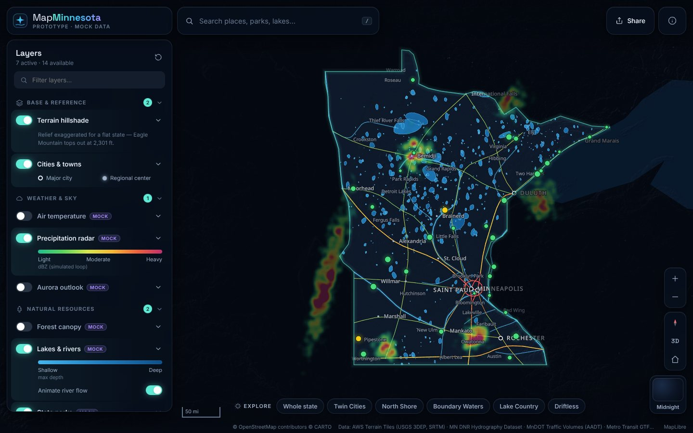
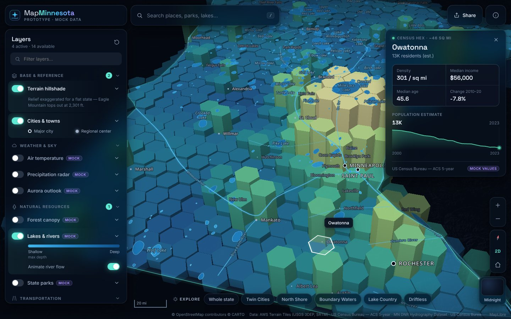
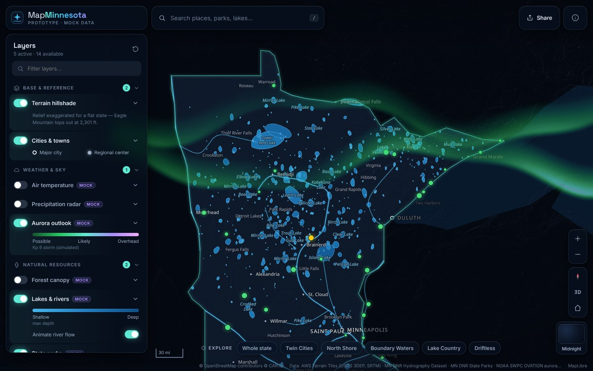
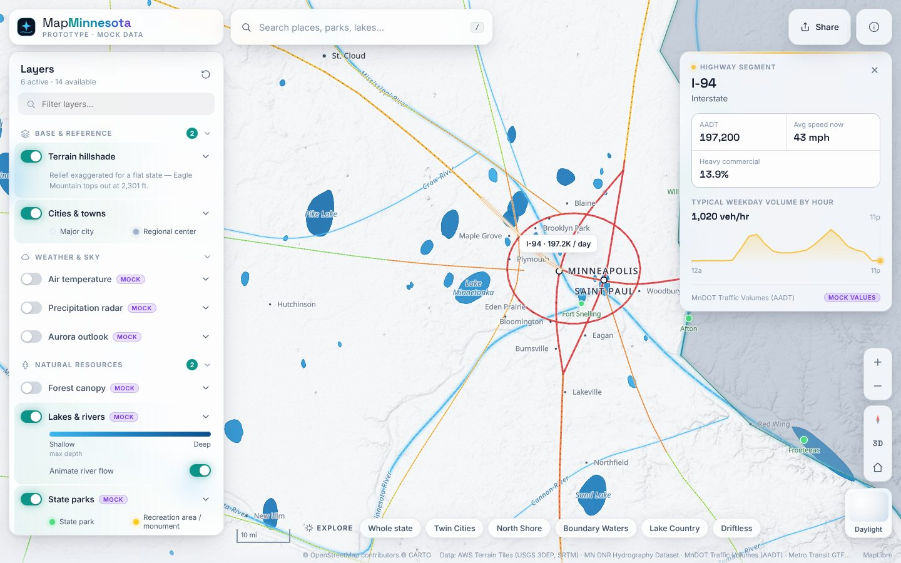

# MapMinnesota

An interactive, map-first atlas of Minnesota: weather, water, roads, people and public land on one map.

> **Status: UI prototype.** Apart from the terrain hillshade and the reference geography (city locations, the state outline), every layer uses **procedurally generated mock data** that is shaped to look plausible. The goal at this stage is the visual language, the interaction model and a layer system that's easy to extend. Real data sources come next.

| | |
| --- | --- |
|  |  |
|  |  |

*The screenshots were taken in a sandbox that couldn't reach the CARTO or Esri tile servers, so they show the self-hosted fallback basemap.*

The full product spec is in [`docs/PROJECT_OVERVIEW.md`](docs/PROJECT_OVERVIEW.md).

## Quick start

```bash
npm install
npm run dev        # http://localhost:5173
npm run build      # typecheck + production build → dist/
npm run preview    # serve the production build
```

Requires Node 18+. No API keys needed.

## What's in the prototype

**Map and visuals**
- Full-screen MapLibre GL map with four basemaps: **Midnight** (dark, the default), **Daylight**, **Satellite** and **North Woods**. North Woods is fully self-hosted.
- Everything outside Minnesota is dimmed and the state border glows. A short camera fly-in plays on first load.
- Layers fade in and out. Motion where it helps: animated traffic and river flow, a radar loop, drifting aurora curtains, moving light-rail trains, and a pulsing highlight on the selected feature.
- 3D tilt and rotation. Census data can be shown as 3D columns, and switching the census variable morphs the colors and heights.

**14 layers in 8 categories**

| Category | Layers |
| --- | --- |
| Base & reference | Terrain hillshade (real DEM), Cities & towns |
| Weather & sky | Precipitation radar (animated), Air temperature surface, Aurora outlook (animated) |
| Natural resources | Lakes & rivers (animated flow), State parks, Forest canopy |
| Transportation | Highways & traffic (AADT, animated), Light rail (Blue/Green lines, simulated trains) |
| People & demographics | Census hex grid: density, income, age, change; 2D or 3D |
| Environment | MPCA regulated sites (clustered, filterable) |
| Public safety | Crime rate per 1,000 residents (normalized, not raw counts) |
| Land ownership | Federal / State / County / Tribal / WMA lands |

**Exploring**
- Layer panel with collapsible categories, a filter box, toggles, opacity, per-layer options, inline legends, source links and "mock" badges.
- Identify cards for clicked features, with key stats, a scrubbable sparkline, chips and the source. Clicking empty ground gives a "what's here" card that reads values from the active layers.
- Search (press `/`) across cities, parks, major lakes and regions, with keyboard navigation.
- "Explore" chips that fly to curated views: Twin Cities, North Shore, Boundary Waters, and more.
- **Shareable URLs:** the hash always encodes the view, basemap, layers, opacity and options. Example: `#v=7.6/45.05/-93.6/-20/55&b=midnight&l=census,water,cities&o=census.var:income;census.extrude:1`
- Mobile layout: the panel and the cards become bottom sheets.
- Basic accessibility: keyboard-reachable controls, ARIA switches and comboboxes, Escape closes cards and dialogs, and `prefers-reduced-motion` is respected.

## Architecture

```
src/
  data/            # geography, color ramps, mock generators, canvas rasters
    geo.ts         #   MN outline, point-in-polygon, hex grid, smoothing, mercator
    mock.ts        #   ← all synthetic datasets (deterministic, memoized)
    raster.ts      #   renders continuous fields (temperature, forest) to images
    places.ts      #   reference cities, parks, lakes, explore views
  layers/          # one LayerDef per layer, grouped by theme
    types.ts       #   the LayerDef contract
    index.ts       #   registry: categories + draw order
  map/
    MapView.tsx    # creates the map, lazy-installs layers, syncs store → map
    basemaps.ts    # base style, basemap palettes, insertion anchors
  components/      # panel, info card, search, controls, legend, sparkline…
  store.ts         # zustand store + URL-hash (de)serialization
```

### Adding a layer

1. Write a `LayerDef` (see `src/layers/types.ts`). It declares a name, category, description, source attribution, defaults, a legend, optional options (select or toggle), and the functions that do the work: `install` (add sources and layers), `paint` (which paint properties the opacity slider scales), and optionally `identify`, `hoverLabel`, `sample`, `animate`, `applyOptions` and `onBasemap`.
2. Add it to `LAYERS` in `src/layers/index.ts`. Its position in that array sets the draw order.

The panel, legend, URL state, attribution, hover, click and fade-in/out all pick up the new layer automatically. A layer isn't installed until someone first turns it on, so unused layers cost nothing at startup.

### Moving from mock to real data

Each mock generator in `src/data/mock.ts` returns plain GeoJSON with the properties its layer reads. To switch a layer to a real feed, point that layer's `install` at the real source. That can be a GeoJSON URL, vector tiles, an ArcGIS REST query or a WMS. Keep the property names, or update the paint expressions to match. Set `mock: false` and the badges disappear.

## Data sources (planned) and attribution

| Layer | Intended source |
| --- | --- |
| Hillshade | AWS Terrain Tiles (USGS 3DEP / SRTM). **Live in the prototype.** |
| Basemaps | © OpenStreetMap contributors © CARTO; imagery © Esri, Maxar, Earthstar Geographics |
| Hydrography, parks, forest | Minnesota DNR via [Minnesota Geospatial Commons](https://gisdata.mn.gov) |
| Highways / AADT | MnDOT traffic volume data (Geospatial Commons) |
| Light rail | Metro Transit GTFS |
| Weather | Open-Meteo, NWS / NOAA MRMS radar, NOAA SWPC aurora |
| Demographics | US Census Bureau ACS 5-year API |
| Regulated sites | MPCA *What's in My Neighborhood* |
| Crime | MN BCA Crime Data Explorer |
| Land ownership | MnGeo statewide parcels (opt-in counties) + public land layers |

Label glyphs (Noto Sans, SIL OFL) are vendored in `public/fonts`, so labels render without a third-party glyph server.

**Offline behavior:** if the CARTO or Esri tiles can't load (offline, or blocked by a firewall), the map falls back to its own Minnesota land and water layers, and the data layers still work.

## Deployment

The build output is a static site, so any static host works: Vercel, Netlify, Cloudflare Pages or GitHub Pages. `base: './'` in `vite.config.ts` keeps asset paths relative, which lets the site run from a subpath.

```bash
npm run build && npx wrangler pages deploy dist   # e.g. Cloudflare Pages
```

## Suggested next steps

1. **Real data, first pass:** DNR hydrography, state parks, MnDOT AADT and the Census ACS API, since these have the highest visual and user value. Pre-tile the heavier ones to PMTiles.
2. **Weather:** live Open-Meteo grid for temperature, plus NWS radar tiles with a time scrubber.
3. **Geocoding:** the DNR Gazetteer, or a hosted geocoder, for addresses.
4. **V1 tools:** measurement, saved views and bookmarks, a historical imagery compare slider, and export to PNG.
5. **More layers:** lake bathymetry, PLS township and range grid, trails and bike routes, broadband coverage, election results, and Emerald Ash Borer detections.
